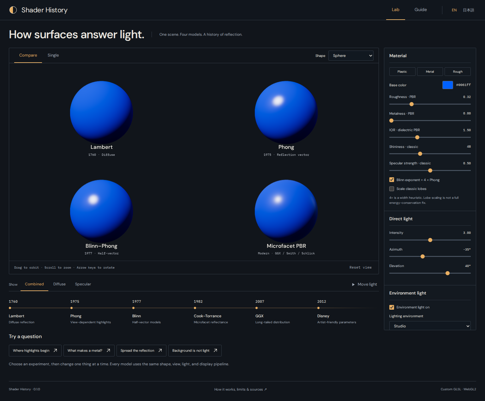
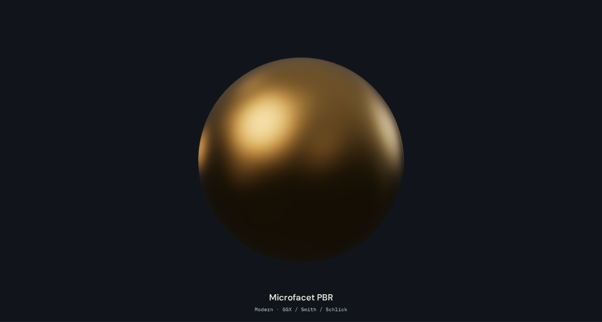
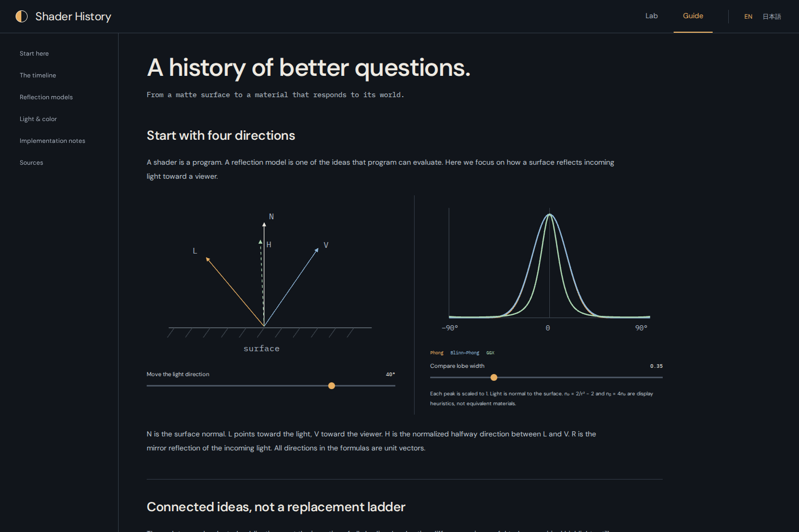

# Shader History

**One scene. Four reflection models. Learn by changing the light.**

Shader History is an English/Japanese interactive guide to Lambert, Phong, Blinn–Phong, and modern microfacet PBR. Compare their actual WebGL output under the same geometry, camera, illumination, and color pipeline, then use the Guide to understand what problems each approach addresses.



## What you can explore

- Four custom GLSL models, side by side or individually
- Synchronized orbit camera; a smooth geodesic sphere, Utah teapot, knot, or rounded cube
- Plastic, metal, and rough-surface presets, with model-appropriate parameters
- Moving direct light, procedural environment lighting, and an independently selected visible background
- Diffuse/specular isolation, exposure, ACES tone mapping, and PNG export
- A bilingual Guide with direction diagrams, a lobe plot, historical context, equations, limitations, and links to primary research

The sphere uses 20,480 roughly uniform triangles with shared vertices and radial smooth normals. It has no latitude/longitude pole fan. The classic implementations are BRDF-style teaching variants, not exact reconstructions of the original papers. PBR is a family of approaches, not one shader invented on a single date.

The initial base color and Plastic/Rough presets use **sRGB #0061ff**, as requested; the Metal preset keeps an illustrative gold color. Presets change material values only. Experiments and **Reset settings** preserve Single/Compare, the selected shader, shape, and camera; use **Compare** or **Reset view** explicitly when desired. ACES is enabled by default for the HDR lighting, while sRGB output is always enabled. These are separate stages, described in the Guide.

The Utah teapot uses the official Three.js addon with analytic patch normals, 18 segments per patch edge (20,592 triangles), and two-sided patch shading. It is centered and uniformly scaled to the sphere’s 1.7-unit maximum extent. All four models share the same selected mesh.

## Get started

**Requirements:** Git, Node.js 24 (with npm), and a WebGL2-capable browser. The Guide remains readable when WebGL2 is unavailable.

```sh
git clone https://github.com/domizo/shader-history.git
cd shader-history
npm ci
npm run dev
```

Open the local URL printed by Vite. To test the production build:

```sh
npm run build
npm run preview -- --host 127.0.0.1 --port 4173
```

Open `http://127.0.0.1:4173`. Access to the repository follows its current GitHub visibility and permissions; these instructions do not imply that a public release has occurred.

Drag to orbit, scroll to zoom, or focus the viewer and use the arrow keys. Light motion is initially paused. Choose **EN / 日本語** in the header; the language preference is stored only in your browser. There is no backend, telemetry, runtime CDN, account system, or external material texture.

## Real rendering and learning guide

These are actual Chromium/WebGL2 captures, not generated concept images. Their source commit and CI provenance are recorded in [the screenshot record](docs/images/README.md).





## Verification and limits

```sh
npm run format:check
npm run check
npm test
npm run build
npx playwright install --with-deps chromium
npm run test:e2e
```

The production-preview browser suite covers real GPU pixels, background/lighting independence, component isolation, moving light, material/shape controls, PNG export, EN/JA Guide navigation, mobile layout, and glossy sphere views. Numerical tests cover the BRDF/color pipeline, sphere topology and smooth normals, and environment-sampling frame continuity.

See the [current verification record](docs/VERIFICATION.md), [implementation notes](docs/IMPLEMENTATION.md), and [primary sources](docs/SOURCES.md). Automated browser evidence uses Chromium with SwiftShader. Physical mobile GPUs, Safari, and every browser/driver combination have not been tested.

This is an educational approximation, not a path tracer. Finite environment samples can leave visible sampling patterns. The common Fresnel-weighted Lambert coupling in the modern material is not strictly energy-conserving at grazing. Cast shadows, interreflection, anisotropy, transmission, subsurface scattering, and multiple-scattering compensation are outside the current scope.

## License

Original project code and documentation: [MIT](LICENSE), copyright © 2026 domizo. Bundled libraries and fonts retain their own licenses; complete notices are in [THIRD_PARTY_NOTICES.md](THIRD_PARTY_NOTICES.md). The npm `private` flag prevents accidental package publication; it does not override the MIT license.

---

## 日本語

**同じシーンに、4つの反射モデル。光を変えて、違いを学ぶ。**

Lambert、Phong、Blinn–Phong、現代の微小面 PBR を、同じ形状・視点・照明・色処理で比較する学習プロジェクトです。単体表示、プラスチック・金属・粗い表面のプリセット、材質のパラメータ、ライトの移動、背景と環境照明の独立操作、拡散／鏡面の分離、PNG 保存を試せます。

球は共有頂点と放射方向の滑らかな法線を持つ、20,480枚のほぼ均一な三角形で構成しています。緯度・経度分割のように極へ多数の三角形が集まる構造ではありません。Guide は方向ベクトルの基礎から、各手法が改善しようとした問題、式、近似の限界、一次資料までを日英で収録しています。

初期色と Plastic／Rough プリセットは、指定された **sRGB #0061ff** です。金属プリセットは観察用の金色を維持します。材質プリセットは材質のみを変え、実験や「設定をリセット」でも単体／比較・選択中のシェーダー・形状・視点を維持します。「比較」「視点を戻す」は明示的に操作できます。ACES は HDR 照明向けの初期設定で、sRGB 出力は常に有効です。両者は別の処理です。

Utah ティーポットは Three.js 公式 addon のパッチ法線を使い、20,592 三角形・両面表示で描画します。中心を揃え、最大幅を球と同じ1.7に一様スケーリングします。4方式とも同じメッシュを共有します。

### ローカルで起動する

**必要なもの：** Git、Node.js 24（npm を含む）、WebGL2 対応ブラウザー。WebGL2 が使えない場合も Guide は読めます。

```sh
git clone https://github.com/domizo/shader-history.git
cd shader-history
npm ci
npm run dev
```

Vite が表示するローカル URL を開きます。本番用ビルドを確認する場合：

```sh
npm run build
npm run preview -- --host 127.0.0.1 --port 4173
```

`http://127.0.0.1:4173` を開いてください。リポジトリへのアクセスは GitHub の現在の公開範囲と権限に従います。この手順は公開切り替えの実施を意味しません。

ドラッグで視点を回転、スクロールで拡大縮小できます。描画領域へフォーカスして矢印キーでも回転できます。上部の EN / 日本語で言語を切り替えます。保存されるのはブラウザー内の言語設定だけで、バックエンドやテレメトリーはありません。

### 検証と注意点

上のスクリーンショットは実際の WebGL2 描画です。[撮影元と CI の記録](docs/images/README.md)、[最新の検証結果](docs/VERIFICATION.md)、[実装の詳細](docs/IMPLEMENTATION.md)、[参考資料](docs/SOURCES.md)を参照できます。検証コマンドは上記の Verification and limits 節に掲載しています。

自動ブラウザーテストは Chromium / SwiftShader で行っています。実機のモバイル GPU、Safari、すべてのブラウザーとドライバーの組み合わせを確認したものではありません。環境光は有限サンプルのため、サンプル模様が残ることがあります。現代モデルの Fresnel 重み付き Lambert 結合も、斜め方向で厳密なエネルギー保存を満たす層状材質モデルではありません。影、相互反射、透過、異方性、表面下散乱、多重散乱補償は含みません。

独自のコードとドキュメントは [MIT ライセンス](LICENSE)です。依存ライブラリとフォントにはそれぞれのライセンスが適用され、全文を [THIRD_PARTY_NOTICES.md](THIRD_PARTY_NOTICES.md) に収録しています。
